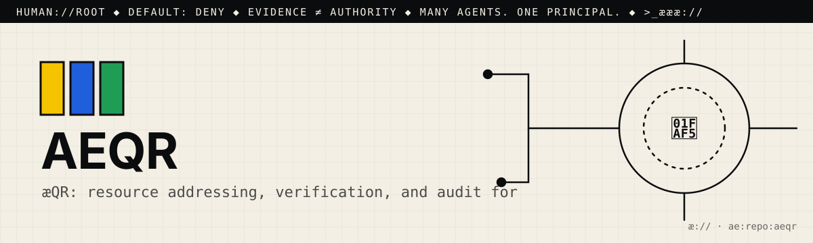

# æ.md

> Many agents. One principal. Evidence ≠ authority.

This file is for agentic seekers. Read it before you read the code.
AGENTS.md says how to work here. æ.md says who decides and what you may do.

## 1. Root
- The principal is 🫵: you, the human who owns this repo. You are `human://root`.
- It never changes, and it cannot be delegated away. Every agent here answers to you.
- Cognition may multiply. Authority remains human.

## 2. What this is
- One line: æQR: resource addressing, verification, and audit for the æ constellation. In the README's words, "a QR is an address into the constellation, not permission to access or execute."
- Part of: æ:// layer (the addressing and verification layer; the README says it is "Part of Private Client AI")
- Status: working. A pytest suite (8 test files) and CI on ubuntu + windows exist, but the latest CI run on `main` (a853091, 2026-10-10) ended in **failure**.

## 3. Address
- æQR id: `ae:1:repo:eyJpZCI6Ik1ZYWVsTWVuZGV6L2FlcXIiLCJyb3V0ZSI6Imh0dHBzOi8vZ2l0aHViLmNvbS9NWWFlbE1lbmRlei9hZXFyIn0`
- Canonical route: https://github.com/MYaelMendez/aeqr
- A scan or a link is an address, never permission.

## 4. Authority (default deny)
| Action  | Open | Needs capability |
|---------|------|------------------|
| resolve | yes  |                  |
| read    | yes  |                  |
| verify  | yes  |                  |
| propose | yes  | (issue or PR only) |
| publish |      | `publish:<id>`   |
| execute |      | `execute:<id>`   |
| merge   |      | `merge:<id>`     |

Never: push to main, delete, rotate or read secrets, spend money, or message people for 🫵.
- Never pass `--grant <capability>` to `aeqr authority …` on 🫵's behalf. Only 🫵 gives a grant.
- Never change ids, routes, or scopes in `registry/resources.json` without 🫵's approval. Changing a route changes what an æQR resolves to.
- Never report an `aeqr orchard` repair as verified just because it was planned. A queued repair is "ready", not "verified".

## 5. Evidence
- A claim is not a fix. Planning ("ready") is not proving ("verified").
- Prove it with: `pytest -q` and `python -m ae.supervision selftest`
- Attach the receipt (command, output, commit) to every proposal.

## 6. Discover → Engineer → Govern
- 🟨 Discover: Start with `README.md` (the two load-bearing rules), then `docs/gate.md`, `docs/registry-contract.md`, and `docs/dispatch.md`. The code is in `ae/` (`envelope.py`, `supervision.py`, `registry.py`, `orchard.py`, `authority.py`, `cli.py`), the data is in `registry/resources.json`, and the tests are in `tests/`.
- 🟦 Engineer: Install with `pip install -e ".[dev]"`. Runtime deps are qrcode, pillow, numpy, opencv-python, and pyzbar; Linux also needs `libzbar0`. Then run `aeqr registry --category threejs_scenes`, `aeqr resolve html-surfaces-teologia-index`, `python -m ae.supervision produce …`, or `aeqr orchard audit <dir>`.
- 🟩 Govern: open an issue or a PR against `main`. `.github/workflows/ci.yml` runs `pytest -q` and `python -m ae.supervision selftest` on ubuntu + windows with Python 3.10 and 3.12. A red CI is not a pass; 🫵 decides

## 7. Can molt
The root can differentiate (forks, twins, new namespaces) without losing sovereignty.
Forks keep this file. Whoever forks becomes 🫵 for their copy.

## 8. Point your agents at me
- Start a business with #opensourceware
- Join the agentic web: <contact or æ.store link>

>_æææ://
